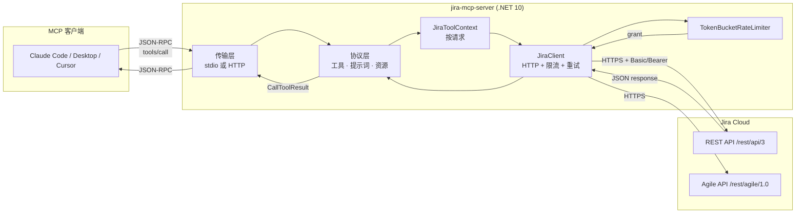
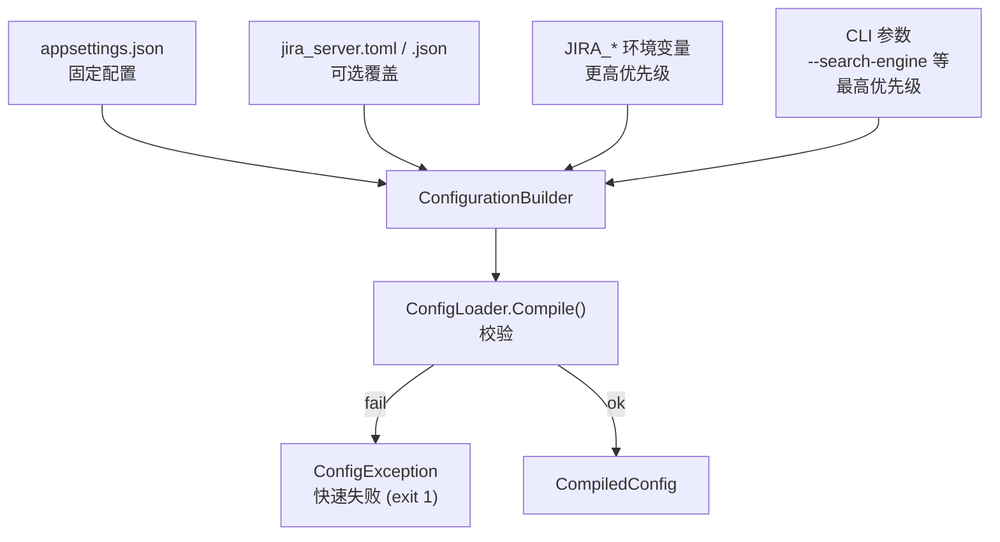
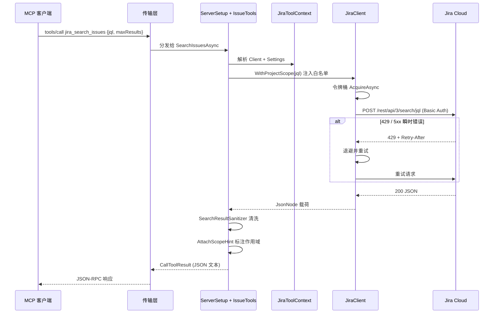
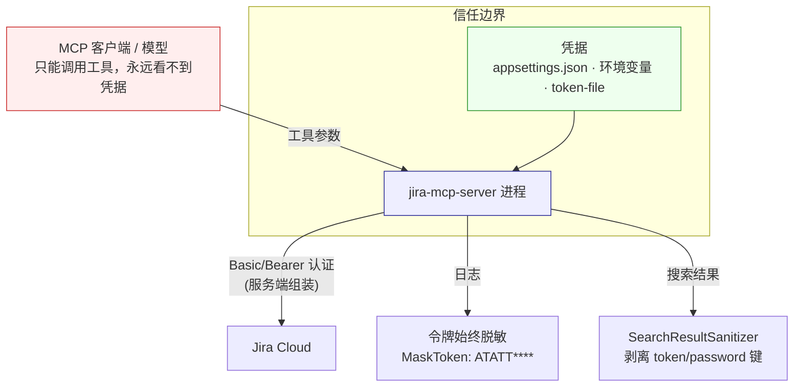
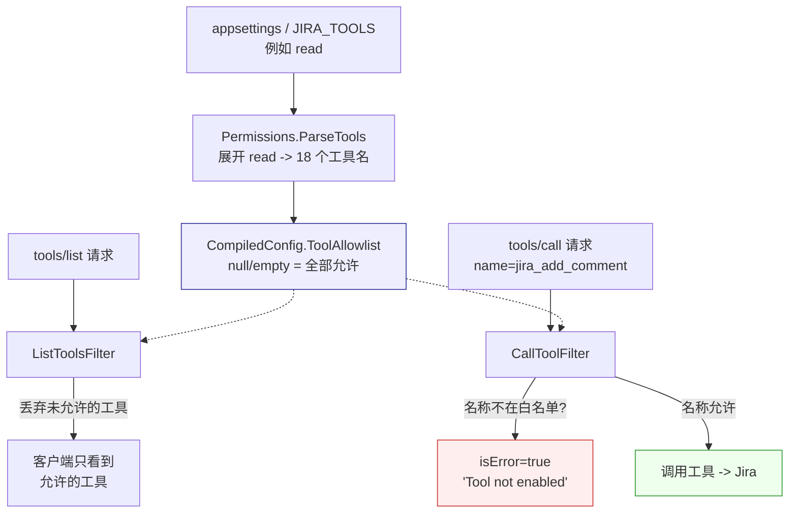

# Jira MCP Server (.NET)

[](LICENSE)
[](https://dotnet.microsoft.com/)
[](https://modelcontextprotocol.io/)

> [English](README.md) | **简体中文**

一个用于 Jira **和 Confluence** 的 Model Context Protocol (MCP) 服务器，使用 C# / .NET 10 实现。
它把 Jira Cloud 的 REST 和 Agile API 暴露为 23 个 MCP 工具（issue 增删改查、搜索、评论、看板等），
并把 Confluence Cloud REST API 暴露为 6 个 wiki/页面/空间工具（4 个读、2 个写），同时提供 4 个提示词模板和
4 个资源，使 Claude Code、Claude Desktop、Cursor 等 MCP 客户端可以直接读写 Jira issue 并读取、创建、更新
Confluence 页面。

## 最近更新

- **修复了 `jira_update_issue` / `jira_transition_issue` / `jira_create_issue` 抛出
  `InvalidOperationException: The node already has a parent.` 的问题** —— 从工具 `fields` 参数解析出来的
  值仍挂在源 `JsonObject` 上，在重新挂到新建的请求体对象时失败。现在每个值在放入请求体之前都会先
  深拷贝（deep clone）。回归测试覆盖了这三条路径。

---

## 目录

- [特性](#特性)
- [架构与交互](#架构与交互)
- [快速开始](#快速开始)
- [配置](#配置)
- [Claude Code 配置](#claude-code-配置)
- [工具参考](#工具参考)
- [提示词与资源](#提示词与资源)
- [安全模型](#安全模型)
- [传输方式](#传输方式)
- [开发](#开发)
- [许可证](#许可证)

---

## 特性

- **23 个 Jira 工具** —— issue 增删改查、搜索、评论、链接、状态流转、附件、工作日志、看板/冲刺
- **6 个 Confluence 工具** —— 获取页面（按 id / URL / 标题）、CQL 搜索、列出/获取空间，基于 ADF 渲染文本；以及创建页面、写入页面内容（Markdown 或 storage 格式）
- **4 个提示词模板** —— bug 报告、冲刺回顾、分诊、每日站会
- **4 个 MCP 资源** —— 项目、项目元数据、issue 快照、状态流转
- **双传输方式** —— stdio（本地，默认）和 Streamable HTTP（团队共享）
- **仅服务端保存凭据** —— 绝不出现在客户端命令行或链路上
- **纵深防御** —— 项目白名单、JQL/CQL 注入防护、工具级权限、令牌日志脱敏
- **弹性** —— 客户端令牌桶限流 + 指数退避重试（遵循 429 的 Retry-After）
- **配置固定于 `appsettings.json`**，可被环境变量和 CLI 覆盖

---

## 架构与交互

### 总体架构



### 配置加载

服务器在启动时合并配置；**后加载的来源会覆盖先加载的**（优先级从低到高）。.NET 的分层配置天然让
环境变量可以覆盖 `appsettings.json` 中的值。



### 工具调用生命周期

以 `jira_search_issues` 为例，从客户端调用到返回结果的完整路径：



### 安全模型



### 工具权限强制

当配置了 `tools`（例如 `read`）时，服务器会在两层执行白名单。一个工具必须同时通过两层才能到达 Jira。



---

## 快速开始

### 前置条件

- .NET SDK 10.0+（[下载](https://dotnet.microsoft.com/download)）
- 一个 Jira Cloud 实例 + API Token（在
  [https://id.atlassian.com/manage-profile/security/api-tokens](https://id.atlassian.com/manage-profile/security/api-tokens) 创建）

### 1. 填写配置

编辑 `src/JiraMcpServer/appsettings.json`，把占位符替换为你的真实凭据：

```json
{
  "base_url": "https://your-domain.atlassian.net",
  "auth_method": "basic",
  "user_email": "you@your-domain.com",
  "api_token": "YOUR_JIRA_API_TOKEN",
  "project_keys": "",
  "tools": "",
  "search_engine": "jql",
  "rate_limit": 100,
  "request_timeout": 30,
  "connect_timeout": 10
}
```

### 2. 构建并运行

```bash
# 构建
dotnet build JiraMcpServer.slnx

# stdio 模式（用于本地客户端）
dotnet run --project src/JiraMcpServer -- --transport stdio

# HTTP 模式（团队共享）
dotnet run --project src/JiraMcpServer -- --transport http --port 8080
```

### 3. 验证

```bash
# 打印版本
dotnet run --project src/JiraMcpServer -- --version
# 输出: jira-mcp-server 0.2.0

# HTTP 模式下的健康检查
curl http://127.0.0.1:8080/health
# {"status":"healthy","server":"jira-mcp-server","version":"0.2.0","transport":"http","jira_configured":true}
```

---

## 配置

所有配置键固定于 `appsettings.json`。.NET 的分层配置保证**环境变量优先于文件**：如果
`appsettings.json` 中设置了 `api_token`，且环境中也设置了 `JIRA_API_TOKEN`，则环境变量生效。
CLI 参数（例如 `--search-engine`）拥有最高优先级。

### 配置键

| 键 | 环境变量 | 说明 | 默认值 |
|---|---|---|---|
| `base_url` | `JIRA_BASE_URL` | Jira URL，必须为 `https://` | —（必填） |
| `auth_method` | `JIRA_AUTH_METHOD` | `basic`（邮箱+令牌）或 `bearer` | `basic` |
| `user_email` | `JIRA_USER_EMAIL` | basic 认证使用的账号邮箱 | basic 必填 |
| `api_token` | `JIRA_API_TOKEN` | Jira API 令牌 | —（必填） |
| `project_keys` | `JIRA_PROJECT_KEYS` | 写入白名单，逗号分隔；空 = 全部 | — |
| `tools` | `JIRA_TOOLS` | 工具白名单：`read,create,update,delete,write` 和/或工具名（逗号分隔）。在 `tools/list`（隐藏）和 `tools/call`（拒绝）两层强制。`read` 只暴露 22 个只读工具；`read,update` 增加 3 个更新工具，以此类推。空/未设置 = 全部 29 个工具。 | 空 = 全部 |
| `search_engine` | `JIRA_SEARCH_ENGINE` | `jql`（默认）/ `get` / `auto`（增强版 search/jql 端点） | `jql` |
| `rate_limit` | `JIRA_RATE_LIMIT` | 每分钟最大请求数 | `100` |
| `request_timeout` | `JIRA_REQUEST_TIMEOUT` | 请求超时（秒） | `30` |
| `connect_timeout` | `JIRA_CONNECT_TIMEOUT` | 连接超时（秒） | `10` |

### 优先级（低 → 高）

1. **`appsettings.json`** —— 固定配置，构建时复制到输出目录
2. **`jira_server.toml` / `jira_server.json`** —— 可选覆盖，在 cwd 或可执行文件目录自动发现
3. **`JIRA_*` 环境变量** —— 覆盖文件中的值
4. **CLI 参数** —— 例如 `--search-engine`，仅在显式传入时覆盖

> 💡 **凭据安全：** 模板 `appsettings.json` 会被跟踪，但包含凭据的变体
> （`appsettings.*.json`、`*.env`、`jira_server.toml`）已被 gitignore。

### CLI 参数

```
--transport <Transport>        stdio | http                         [默认: stdio]
--token-file <token-file>      指向 KEY=VALUE 凭据文件的路径
--search-engine <search-engine> jql | get | auto                     [默认: jql]
--host <Host>                   HTTP 绑定主机                         [默认: 127.0.0.1]
--port <Port>                   HTTP 绑定端口                         [默认: 8080]
--auth-mode <Mode>              none | token                          [默认: none]
--server-token <Token>          HTTP 客户端 bearer 令牌
--cors-origins <Origins>        CORS 来源，逗号分隔                     [默认: *]
--log-level <Level>             DEBUG | INFO | WARNING | ERROR        [默认: INFO]
--version                       打印版本并退出
```

---

## Claude Code 配置

### 方式 A：stdio 模式（本地推荐）

在项目根目录创建 `.mcp.json`，或添加到 `~/.claude.json` 的 `mcpServers` 块：

```json
{
  "mcpServers": {
    "jira": {
      "command": "dotnet",
      "args": [
        "run",
        "--project",
        "E:/bs/code/others/jira_mcp_server_net/src/JiraMcpServer",
        "--",
        "--transport",
        "stdio"
      ]
    }
  }
}
```

或直接使用构建好的二进制（启动更快）：

```json
{
  "mcpServers": {
    "jira": {
      "command": "E:/bs/code/others/jira_mcp_server_net/src/JiraMcpServer/bin/Debug/net10.0/jira-mcp-server.exe",
      "args": ["--transport", "stdio"]
    }
  }
}
```

也可以通过 CLI 添加：

```bash
claude mcp add jira -- dotnet run --project E:/bs/code/others/jira_mcp_server_net/src/JiraMcpServer -- --transport stdio
```

### 方式 B：HTTP 模式（团队共享）

先启动服务器：

```bash
dotnet run --project src/JiraMcpServer -- --transport http --port 8080 --auth-mode token --server-token "shared-secret"
```

然后配置 `.mcp.json`：

```json
{
  "mcpServers": {
    "jira": {
      "type": "http",
      "url": "http://your-server:8080/mcp",
      "headers": {
        "Authorization": "Bearer shared-secret"
      }
    }
  }
}
```

### 验证连接

在 Claude Code 中运行：

```
/mcp
```

你应该能看到 `jira` 服务器及其 29 个工具。然后可以自然地对话：

> "搜索项目 PROJ 中所有未关闭的 bug"

Claude 会自动调用 `jira_search_issues`。

---

## 工具参考

全部 29 个工具（23 个 Jira + 6 个 Confluence），按模块分组。每个工具的参数通过 MCP 的
`inputSchema` 暴露给客户端。

### Issues（14 个）

| 工具 | 说明 |
|---|---|
| `jira_create_issue` | 创建 issue，自动把文本转为 ADF |
| `jira_update_issue` | 更新 issue 字段 |
| `jira_get_issue` | 获取 issue 详情，可选 fields/expand |
| `jira_delete_issue` | 删除 issue（需要 `confirm=true`） |
| `jira_transition_issue` | 按 id 或目标状态流转 |
| `jira_get_transitions` | 列出可用状态流转 |
| `jira_add_comment` | 添加评论，可选可见范围 |
| `jira_get_comments` | 分页获取评论 |
| `jira_link_issues` | 链接两个 issue |
| `jira_get_issue_links` | 获取 issue 链接 |
| `jira_search_issues` | JQL 搜索，自动注入白名单 |
| `jira_search_issues_jql_only` | 精简搜索（仅 key/summary/status/assignee） |
| `jira_get_issue_meta` | 创建 issue 的元数据 |
| `jira_get_project_meta` | 项目元数据 |

### Projects（3 个）

| 工具 | 说明 |
|---|---|
| `jira_list_projects` | 列出可访问项目（摘要） |
| `jira_get_project` | 获取单个项目 |
| `jira_get_project_versions` | 获取项目版本 |

### Boards & Sprints（4 个）

| 工具 | 说明 |
|---|---|
| `jira_list_boards` | 列出看板，按项目/类型过滤 |
| `jira_list_sprints` | 列出看板中的冲刺 |
| `jira_get_sprint_issues` | 获取冲刺中的 issue |
| `jira_move_issues_to_sprint` | 把 issue 移入冲刺 |

### Users（2 个）

| 工具 | 说明 |
|---|---|
| `jira_search_users` | 按名称/邮箱搜索用户（隐私过滤） |
| `jira_get_myself` | 获取当前认证用户 |

### Attachments（2 个）

| 工具 | 说明 |
|---|---|
| `jira_add_attachment` | 上传本地文件，超过 10 MiB 拒绝 |
| `jira_list_attachments` | 列出 issue 上的附件 |

### Worklogs（2 个）

| 工具 | 说明 |
|---|---|
| `jira_add_worklog` | 记录耗时（如 `2h 30m`） |
| `jira_get_worklogs` | 获取 issue 的工作日志 |

### Confluence（6 个：4 个读、2 个写）

读取使用 Confluence Cloud 经典 API（`/wiki/rest/api`），与 Jira 工具共用相同的服务端凭据、
限流、重试和令牌脱敏。ADF 页面正文会被渲染为可读的纯文本；页面 URL 会被解析，因此粘贴一个
`…/wiki/spaces/KEY/pages/12345/Title` 链接可以直接使用。

| 工具 | 说明 |
|---|---|
| `confluence_get_page` | 按 id、完整页面 URL 或标题获取页面；返回标题、空间、URL 和渲染后的正文文本 |
| `confluence_search` | 用 CQL 搜索页面/内容（如 `space = 'PE' AND text ~ 'bonus'`） |
| `confluence_list_spaces` | 列出可访问的 Confluence 空间（key、名称、类型） |
| `confluence_get_space` | 按 key 获取单个 Confluence 空间 |
| `confluence_create_page` | 在空间中创建页面（可指定父页面）并写入内容 |
| `confluence_update_page` | 向已有页面写入内容：替换整个正文或追加到末尾；版本号自动递增，可同时修改标题 |

写入工具的内容支持 **Markdown**（默认；标题、无序/有序/嵌套列表、表格、围栏代码块、引用、
粗体/斜体/删除线/行内代码和链接会被转换为 Confluence storage 格式），也可通过
`body_format='storage'` 直接传入 Confluence **storage 格式** XHTML。Markdown 中的字面 `<`/`&`
会被转义，`javascript:` 之类的链接协议会被丢弃。`confluence_create_page` 属于 `create` 权限类别，
`confluence_update_page` 属于 `update`，因此限定为 `read` 的部署不会暴露它们。
出于安全不提供删除页面；正文为空的更新会被拒绝，避免误清空页面（历史版本仍保留在页面历史中）。

---

## 提示词与资源

### 提示词（4 个工作流模板）

| 提示词 | 说明 |
|---|---|
| `create_bug_report` | 引导创建结构化的 bug 报告 |
| `sprint_review_summary` | 生成冲刺回顾摘要 |
| `triage_issue` | 起草分诊建议 |
| `daily_standup_report` | 生成每日站会报告 |

### 资源（4 个只读上下文）

| 资源 URI | 说明 |
|---|---|
| `jira://projects` | 可访问的项目 |
| `jira://project/{projectKey}/meta` | 项目创建 issue 的元数据 |
| `jira://issue/{issueKey}` | issue 快照 |
| `jira://issue/{issueKey}/transitions` | 可用状态流转 |

---

## 安全模型

1. **仅服务端保存凭据** —— Jira 的 `api_token`、`user_email` 和 `base_url` 只从
   `appsettings.json` / 环境变量 / `--token-file` 读取，**绝不**从 CLI 参数读取，因此启动命令
   （对 MCP 客户端可见）永远不会暴露令牌。

2. **令牌脱敏** —— 日志中的令牌一律脱敏为 `ATATT****`；`Safety.MaskToken` 和
   `SearchResultSanitizer` 还会递归清洗响应中类似令牌的字符串以及 `token`/`password`/`authorization` 等键。

3. **项目白名单** —— 设置 `project_keys` 后，写入在请求前被拒绝，JQL 搜索会自动注入
   `project in (...)` 子句；结果会带 `scope` 提示。

4. **JQL 注入防护** —— `Jql.Build` 是唯一的 JQL 组合器；所有字面量都通过 `EscapeValue` 转义以防止注入。

5. **工具级权限** —— `tools` 配置限制哪些工具可用。类别 `read/create/update/delete/write` 会展开为具体
   工具名；也可以列出单个名称（逗号分隔，如 `read,update`）。通过两个 MCP 请求过滤器实现纵深防御：
   `tools/list` 隐藏未允许的工具，使模型不会把它们列出；`tools/call` 对它们的调用返回 `isError` 结果——
   因此一个限定为 `read` 的部署即使客户端绕过列表，也无法调用写工具。拼写错误会在启动时快速失败。
   全部 29 个工具都被精确映射到一个类别（已验证：无遗漏、无重叠）：

| 类别 | 工具数量 | 示例工具 |
|---|---|---|
| `read` | 22 | `jira_get_issue`、`jira_search_issues`、`jira_list_projects`、`confluence_get_page`、`confluence_search`、`confluence_list_spaces`、`confluence_get_space` |
| `create` | 7 | `jira_create_issue`、`jira_add_comment`、`jira_add_attachment`、`jira_add_worklog`、`jira_link_issues`、`jira_move_issues_to_sprint`、`confluence_create_page` |
| `update` | 3 | `jira_update_issue`、`jira_transition_issue`、`confluence_update_page` |
| `delete` | 1 | `jira_delete_issue` |

6. **强制 HTTPS** —— `base_url` 必须以 `https://` 开头；明文 HTTP 会被拒绝。

---

## 传输方式

### stdio（默认）

适合本地客户端（Claude Desktop、Cursor、VS Code）。服务器从自身进程环境读取配置；客户端的启动命令
不携带任何凭据。stdout 专用于 JSON-RPC 通道；日志走 stderr。

### Streamable HTTP

适合在终止 TLS 的反向代理后进行团队共享部署。用 `--auth-mode token --server-token` 保护客户端连接。
端点：`/mcp`（MCP）、`/health`、`/`（信息页）。

---

## 开发

### 项目结构

```
src/JiraMcpServer/
├── Program.cs                    CLI 入口、参数解析
├── appsettings.json              固定配置模板
├── Configuration/ConfigLoader.cs 分层配置 + 校验
├── Jira/
│   ├── Client/JiraClient.cs      HTTP 客户端：限流 + 重试 + 分页
│   ├── Client/ConfluenceClient.cs Confluence 经典 API 客户端（共享 Jira 管道）
│   ├── Errors/JiraError.cs       错误层级
│   ├── Formatters/Adf.cs         ADF <-> 文本
│   ├── Formatters/ConfluenceAdf.cs Confluence ADF 渲染器（表格、面板、媒体）
│   ├── Formatters/ConfluenceStorage.cs Markdown → Confluence storage 格式（用于页面写入）
│   ├── Formatters/HtmlToText.cs  storage 正文的 HTML 回退
│   ├── Safety/Safety.cs          脱敏、清洗
│   └── Validators/Jql.cs         安全的 JQL 构建器
│   └── Validators/Cql.cs         安全的 CQL 构建器
│   └── Validators/ConfluenceUrl.cs 页面 URL 解析器
├── Server/ServerSetup.cs         共享 DI 装配（工具/提示词/资源）
├── Tools/                        MCP 工具/提示词/资源定义
│   ├── Issues/  Projects/  Sprints/  Users/  Attachments/  Worklog/  Confluence/
│   ├── Prompts/  Resources/  Permissions/  Serde/
│   └── JiraToolContext.cs         按请求的上下文
└── Transport/
    ├── Stdio/StdioHost.cs        stdio 传输
    └── Http/HttpHost.cs           HTTP 传输
tests/JiraMcpServer.Tests/        测试项目
```

### 构建与测试

```bash
dotnet build JiraMcpServer.slnx
dotnet test JiraMcpServer.slnx
```

### 技术栈

- .NET 10、C# 13
- [ModelContextProtocol SDK 2.1.0](https://www.nuget.org/packages/ModelContextProtocol) —— MCP 协议
- [System.CommandLine 2.0.10](https://www.nuget.org/packages/System.CommandLine) —— CLI 解析
- ASP.NET Core Kestrel —— HTTP 传输
- [Tomlyn](https://www.nuget.org/packages/Tomlyn) —— TOML 配置
- `System.Threading.RateLimiting` —— 令牌桶限流

---

## 许可证

遵循 [Apache License, Version 2.0](LICENSE)。

```
Copyright 2026 Jira MCP Server (.NET) contributors

Licensed under the Apache License, Version 2.0 (the "License");
you may not use this file except in compliance with the License.
You may obtain a copy of the License at

    http://www.apache.org/licenses/LICENSE-2.0

Unless required by applicable law or agreed to in writing, software
distributed under the License is distributed on an "AS IS" BASIS,
WITHOUT WARRANTIES OR CONDITIONS OF ANY KIND, either express or implied.
See the License for the specific language governing permissions and
limitations under the License.
```
